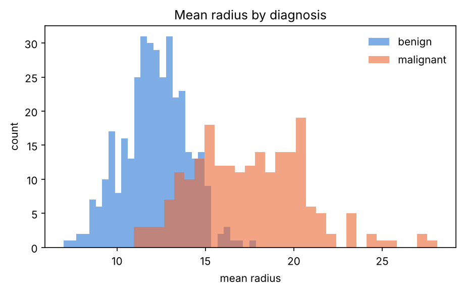
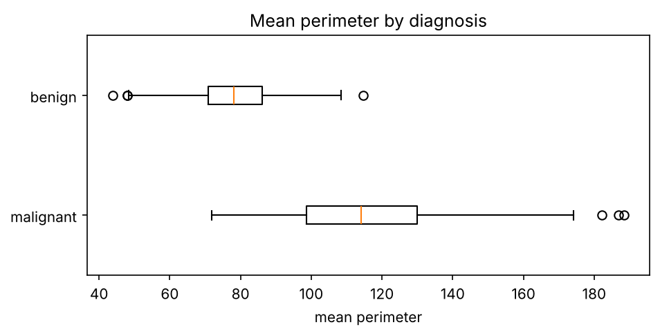
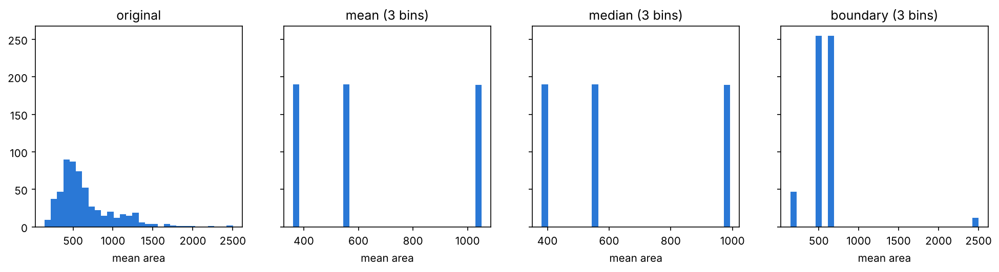
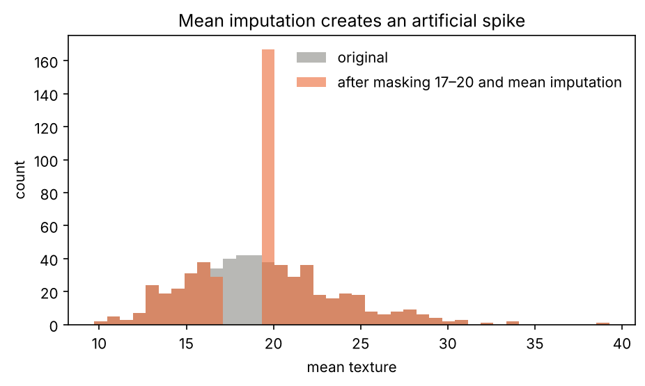

# Exploratory Analysis and Preprocessing of Breast Cancer Diagnostic Data

A reproducible exploratory study of the **Wisconsin Diagnostic Breast Cancer** dataset
(569 tumours, 30 cell-nucleus features, 357 benign / 212 malignant). It covers distributions,
feature relationships, normalisation, smoothing by binning, outlier analysis and imputation.
The emphasis is on what each preprocessing step does to the data, not only on applying it.

> Developed from a graduate Data Mining course assignment at Isfahan University of Technology,
> then consolidated into a single pipeline and extended with class-aware analysis.



## Findings

**Size features are almost redundant.** Mean radius correlates at 0.998 with mean perimeter and
0.987 with mean area. This follows from geometry (perimeter ∝ r, area ∝ r²). For modelling,
one of the three carries nearly all of the information.

**The radius distribution is right-skewed** (skewness 0.94): mean 14.13 > median 13.37 > mode 12.34,
with harmonic mean 13.35. The long right tail is formed by malignant tumours.

| Statistic | Min | Q1 | Median | Q3 | Max | Mean | SD |
|---|---:|---:|---:|---:|---:|---:|---:|
| mean radius | 6.98 | 11.70 | 13.37 | 15.78 | 28.11 | 14.13 | 3.52 |

**"Outliers" here are diagnostically meaningful, not errors.** The 1.5·IQR rule flags 13 tumours on
mean perimeter. *All 13 are malignant.* Removing them as a cleaning step would delete exactly the most
clinically important cases. Outlier detection also depends on the reference population: on mean texture,
the pooled data contain 7 IQR outliers, while the benign class alone contains 18.



**Smoothing by binning trades detail for robustness.** For mean area with 3 equal-frequency bins, the
reconstruction RMSE is 198 for bin means, 202 for bin medians and 247 for bin boundaries.



**Mean imputation distorts the distribution.** To simulate missingness, the 164 texture values in [17, 20]
were masked and then imputed with the mean of the remaining values (19.62). The standard deviation barely
changes (4.30 → 4.25), because the fill value lies inside the masked range. The histogram, however,
shows an artificial spike. Summary statistics alone would hide this distortion. The example also shows
why missingness that depends on the value itself (MNAR) cannot be repaired by mean imputation.



## Usage

The dataset ships with scikit-learn, so no download is needed.

```bash
pip install -r requirements.txt
python src/eda.py --out results          # writes figures and summary.json
python src/eda.py --bins 5 --out results # try a different number of bins
```

## Structure

```
src/eda.py        complete pipeline: statistics, figures, preprocessing experiments
results/          generated figures and summary.json (every number in this README)
```

## License

MIT
